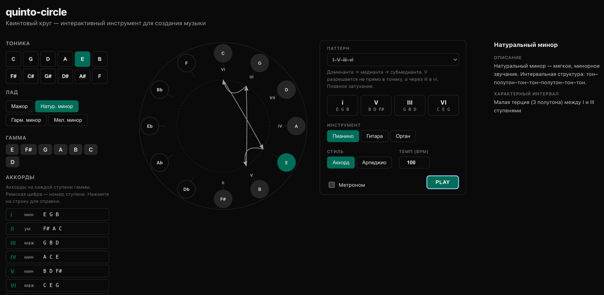

# quinto-circle

An interactive circle of fifths — a tool for exploring harmony, building chord progressions, and playing them back.

**[Live demo](https://evgenykon.github.io/quinto-circle/)**



## Features

- **Circle of fifths:** 12 notes arranged clockwise, highlighting the tonic and scale degrees
- **Key selection:** major, natural/harmonic/melodic minor
- **Scale & chords:** scale degrees I–VII with chord types
- **Theory panel:** reference for key signatures, scale degrees, and chromatic notes
- **Player:** 50 built-in chord progressions, chords and arpeggios, 3 instruments (piano, guitar, organ), adjustable tempo, metronome
- **Visualization:** chord movement graph inside the circle, current chord highlighting
- **Chord detector:** vertical guitar fretboard (5 frets with scroll along the neck), clickable strings,
  open strings and tuning presets — the chord name is recognized automatically
  ([`/chords`](https://evgenykon.github.io/quinto-circle/chords))
- **Chord tree:** pick a central chord and see every allowed progression branching out from it in all
  directions; branches end on a chord that can return to the centre. Filter by mode, style
  (functional, pop, rock, blues, jazz), triads/sevenths, mood (light, sad, tense) and depth 2–8.
  Chords keep one colour (major warm, minor cold); clicking a chord shows its fingering on the neck
  ([`/tree`](https://evgenykon.github.io/quinto-circle/tree))

- **Rehearsal notebook:** A4 page per screen with an 8×4 interactive table — part labels (Intro, Chorus…)
  in a narrow vertical strip, up to 4 chords per cell, a note field, a chord diagram picker and a
  tab editor (up to 8 notes). Multiple pages, autosave to localStorage, JSON export/import and printing
  ([`/notebook`](https://evgenykon.github.io/quinto-circle/notebook))

## Getting started

```bash
make build    # build Docker image
make dev      # start dev server at http://localhost:3000
make down     # stop the server
make test     # run chord-detection checks inside the container
```

## Stack

- Nuxt 3 + Vue 3
- Web Audio API (synthesis without external libraries)
- SVG graphics
- Docker

## Development

Commands run inside the Docker container:

```bash
make run cmd="yarn add <package>"
make down && make dev   # restart after adding dependencies
```
